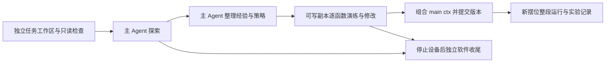

# RAX Human — Piper 真机探索、函数演练与自动执行

基于 [RAX](https://github.com/robot-agent-exploration/rax) 的 `real/franka` 工作流，面向双臂 Piper、头部相机和双腕相机的受监督真机实现。保留 **探索 → 经验整理 → 逐函数演练 → 组合 `main(ctx)` → 新摆位测试** 的阶段划分，不把模型的每一次思考变成固定的运动控制环节。

本仓库发布当前工程实现、可复用技能、已经运行成功的蓝杯控制器、积木任务候选以及实验 Web。它不是 RAX 官方仓库，也不声称复现论文全部实验。README 的组织参考上游的安装、运行、架构与测试说明。

## 当前状态

| 内容 | 状态与边界 |
|---|---|
| Piper owner、状态、三路相机、动作回执 | 导出当前适配实现；设备配置和标定对应原实验设备 |
| 蓝杯放杯垫 v0.4.0-rc10 | 已有多轮成功记录的逐函数组合 `main(ctx)`；源码及原始哈希保留在 `demos/piper-blue-cup-v0.4` |
| 积木 L 形搭建 | 探索成功，含现场确认；函数代码仍为演练候选，不标为已通过整段测试 |
| 多路点轨迹 v0.6 | 独立实验版，不能替代已验证的 v0.4 |
| 主 Agent 独立软件收尾 | 已做离线验证；本次发布未做新的真实模型收尾或真机测试 |
| 新机器安装 | 源码和部署配置已提供；SDK、FFS 权重、MoveIt 环境和设备实测标定需要单独准备 |

## 工作流



- **探索**：Agent 根据当前观测试验方法，记录成功、失败、人工协助和未解决的问题，不继承其他任务的摆位和抓取参数。
- **逐函数演练**：由 RAX 主 Agent 编写、调用、检查和修改函数。函数接收 `ctx` 与明确输入，返回结果和证据；正常子步骤由函数内部完成，异常再交回 Agent。
- **经验与软件收尾**：主 Agent 负责，不交给 Mac 代写。设备停止、撤销写入并确认退出后，单独进入没有机器人接口的代码阶段。该阶段不继承探索时间／调用预算；用户停止、模型错误仍会终止它。详见 [收尾约定](docs/WORKFLOW.md)。
- **组合与测试**：演练通过后才组合 `main(ctx)`。合并不等于拼成连续轨迹。整段测试不启动主 Agent；初始视觉定位仍可能调用 Gemini，异常时可兜底。
- **Mac**：监督、查看证据、归档和发布；不能把主机生成的候选误写为 Agent 已独立验证的成果。

对应技能：[逐函数演练](skills/rax-rehearse-functions/SKILL.md)、[组合与规模测试](skills/rax-compose-and-test/SKILL.md)。上游依据：[autonomous-control](https://github.com/robot-agent-exploration/rax/blob/real/franka/agent_skills/task/autonomous-control/SKILL.md)、[experience-memory](https://github.com/robot-agent-exploration/rax/blob/real/franka/agent_skills/task/experience-memory/SKILL.md)、[真机适配指南](https://github.com/robot-agent-exploration/rax/blob/main/docs/REAL_ROBOT_ADAPTATION.md)。

## 架构

```text
RAX 主 Agent / 无 Agent 的 main(ctx)
                 │ 受限 frontend / Unix socket
                 ▼
backend + 几何/路径检查 + 动作回执 + 按需感知
                 │
         XPolicy owner（唯一设备写入者）
                 │
           Piper / 三路相机
```

头部双目通过 FFS 提供深度，结合当前头部标定定位。左腕 RGB 用于遮挡补充，左腕 FFS 可按需取深度；**腕部手眼尚未完成时，其点只在相机坐标系内，不能直接作为基座目标**。视觉描述可见的夹持、滑移、支撑等事实；隐藏间隙、整段未接触不能由一张照片证明。数值前置条件和控制结果优先由普通代码检查，Gemini 不固定夹在每个动作前后。

本轮接近中的三维目标可跨函数保留，前提是目标身份和参考系仍有效；换摆位必须重新初始定位，不能重放旧像素。不同位置还受 IK、姿态、碰撞与工作区共同约束。

## Requirements

- 真机端 Linux、Python 3.12、Git、bubblewrap、可用的 CAN 与相机设备。
- 当前设备采用 pyAgxArm 1.0.0、Dora 0.5、python-can 4.6.1、pyrealsense2 2.58.3.10794；部署前核对实际固件和 SDK 配对。
- FFS 的独立环境和权重；MoveIt 2 的独立环境及 IK 服务。安装清单见 [复现指南](docs/REPRODUCE.md)。
- 主模型 API 与 Gemini 凭据放在仓库之外。本仓库不含密钥、登录态、模型权重、虚拟环境、设备运行日志或连续录像。

## Setup：先离线，再接入

```bash
git clone https://github.com/CoCoMatrix/rax-human.git
cd rax-human
python3 -m venv .venv
.venv/bin/pip install -r requirements.txt
PYTHONPATH=. .venv/bin/python -m pytest -q
cp site.example.json site.local.json
.venv/bin/python scripts/doctor.py
```

`doctor` 只检查路径，不读取密钥或启动设备。填写 `site.local.json` 中本机依赖路径；该文件被 Git 忽略。原 5090 可从 `site.5090.example.json` 复制后复用已有依赖，这些示例只有路径，不含凭据。**不要将本仓库覆盖到正在运行的目录。**

完整命令、模型设置、部署依赖及首次只读接入见 [REPRODUCE.md](docs/REPRODUCE.md)。默认启动脚本只输出计划，`--run` 才实际启动；Web 的 Prepare/执行按钮会操作硬件，需当次现场条件满足。

## Usage：独立任务与演练

```bash
# 仅生成探索启动计划
PYTHONPATH=. .venv/bin/python scripts/piper_explore.py \
  --task-config examples/tasks/magnetic-blocks-l-stack/session.json \
  --output commissioning/blocks-explore-001 --seconds 2400 --max-model-calls 160 --direct-model

# 将积木候选放入新的可写工作区；这不代表它通过演练
.venv/bin/python scripts/prepare_workspace.py \
  --source examples/controllers --name blocks/rehearsal-001 --apply

# 逐函数演练计划：加 --run 才启动设备与新 Agent 会话
PYTHONPATH=. .venv/bin/python scripts/piper_explore.py \
  --task-config examples/tasks/magnetic-blocks-l-stack/rehearsal-session.json \
  --rehearsal-candidate workspaces/blocks/rehearsal-001 --rehearsal-agent \
  --output commissioning/blocks-rehearsal-001 --seconds 2400 --max-model-calls 160 --direct-model
```

新任务应复制任务模板，填写自身目标、工作区和初始经验。复用设备接口、标定、工具验收事实，不复制蓝杯的 3 mm 闭合、下降高度、当前观测或历史现场许可。已有成功探索的记忆应通过明确的导入／交接保留来源。

## 已调通 Demo：蓝杯 v0.4 `main(ctx)`

原始演练／合并控制器位于 [demos/piper-blue-cup-v0.4](demos/piper-blue-cup-v0.4)，入口为 `code/blue_cup/controller.py:main(ctx)`。`DEMO.json` 保存原始提交、文件哈希和设备参数；`validation-runs.json` 保存历史运行摘要。它正常运行不需要主 Agent，但不是“完全没有视觉定位”的脚本。

```bash
.venv/bin/python scripts/prepare_workspace.py \
  --source demos/piper-blue-cup-v0.4 \
  --name blue-cup/20261109-v0.4-merged-candidate --speed-profile faster --apply
# 配置好 site.local.json 后，只启动 Web 服务，此命令不启动机械臂
PYTHONPATH=. .venv/bin/python -m services.dashboard.piper_scale --port 8781
```

浏览器连接方法见复现指南。控制台提供三路相机、只读连接、原生 XPolicy Prepare、一次任务执行、停止和实验记录。杯子／杯垫的位置由本轮初始视觉获取，**没有手工输入摆位坐标的步骤**。记录版本、阶段耗时、辅助视觉次数、总耗时和失败原因。

v0.4 当前配置：50% SDK 速度、3 mm 抓取、40 mm 试抬、0.01 rad 关节判断、0.3 s 持稳（至少 4 个样本）、单次位姿位移上限 400 mm，工作区 X 上限 500 mm。这些是本设备的既有选择，不是 Franka 默认值，也不是其他夹爪／任务的通用参数；500 mm 工作区不保证某个姿态一定有 IK 解。

## Repository layout

| 路径 | 内容 |
|---|---|
| `harness/`, `auto_research_agent/`, `agent_blocks/` | 主 Agent 会话、沙箱、压缩与独立软件收尾 |
| `services/` | 通用 frontend、Piper backend、相机／深度、控制、Web |
| `scripts/` | 计划／启动／停止、任务与工作副本管理、验收工具 |
| `agent_skills/`, `skills/` | RAX 任务技能和本设备的演练／组合经验 |
| `examples/tasks/`, `examples/controllers/` | 独立任务模板、积木演练候选 |
| `demos/` | v0.4 已调通控制器、独立轨迹实验版 |
| `integrations/` | 当前依赖的 Piper legacy、XPolicy owner、policy adapter、MoveIt 源码 |
| `docs/`, `local_tests/`, `tests/` | 说明、验收与离线回归 |
| `web-console/` | 原独立 Web 打包入口；本仓库优先使用根目录服务 |

## Tests and limitations

`pytest.ini` 选择可在无硬件环境运行的发布回归集。其他历史测试保留用于诊断，部分依赖原实验记录、Linux 环境或硬件，不承诺任意机器直接全量运行。测试通过不能替代 SDK、相机同步、碰撞几何、工具特性和真实摆位的验收。

发布验证见 [PUBLICATION-VALIDATION.md](docs/PUBLICATION-VALIDATION.md)。本次打包没有启动、停止或修改正在运行的真机任务，也没有覆盖冻结控制器。已知边界包括腕部手眼未完成、环境／指尖碰撞资产仍需按实际安装核对、关节反馈存在厂商滤波、API 长尾以及不同摆位的 IK 可达性。详细历史问题及处理见两份 skill 与 `docs/`。`docs/` 的日期报告及 `UPSTREAM.json` 的早期验收描述是历史记录，当前入口与状态以本 README、复现指南和发布验证为准。

## Attribution and license

RAX 来源、分支及提交见 [UPSTREAM.json](UPSTREAM.json)。上游 Apache-2.0 许可证保留于 [LICENSE](LICENSE)；其他来源及许可边界见 [THIRD_PARTY_NOTICES.md](THIRD_PARTY_NOTICES.md)。本仓库不包含或重新授权厂商固件、模型权重、SDK 二进制与第三方依赖。
